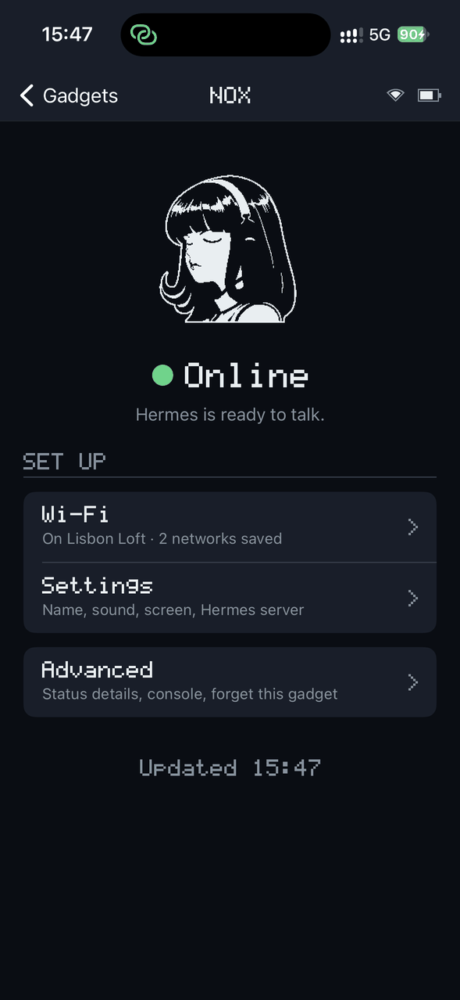
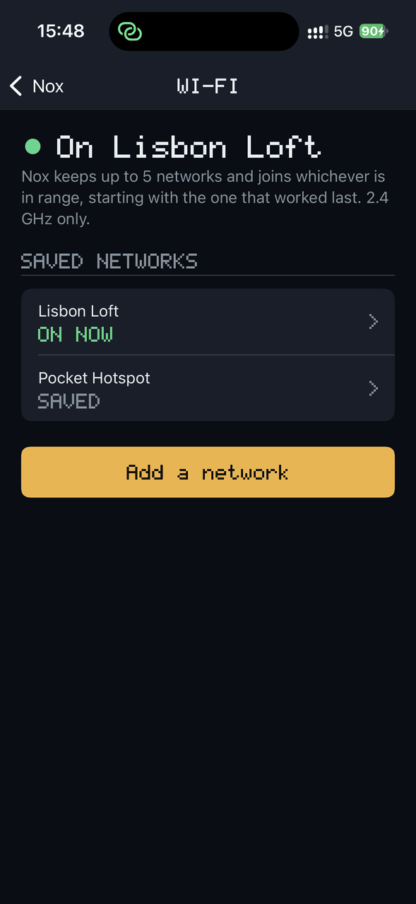
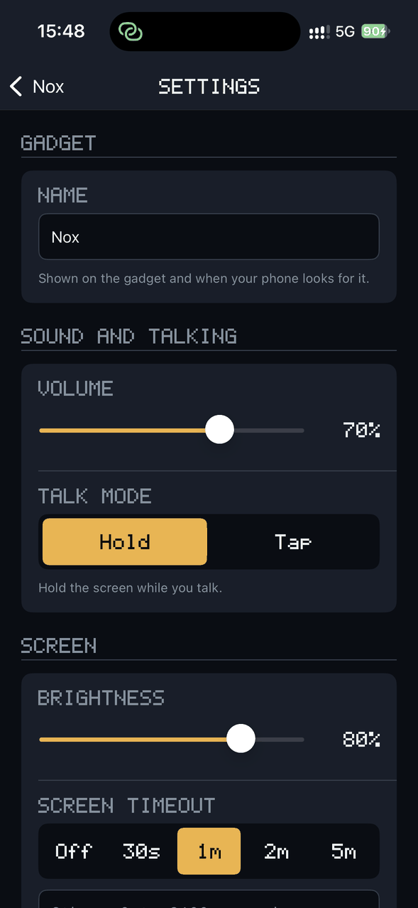
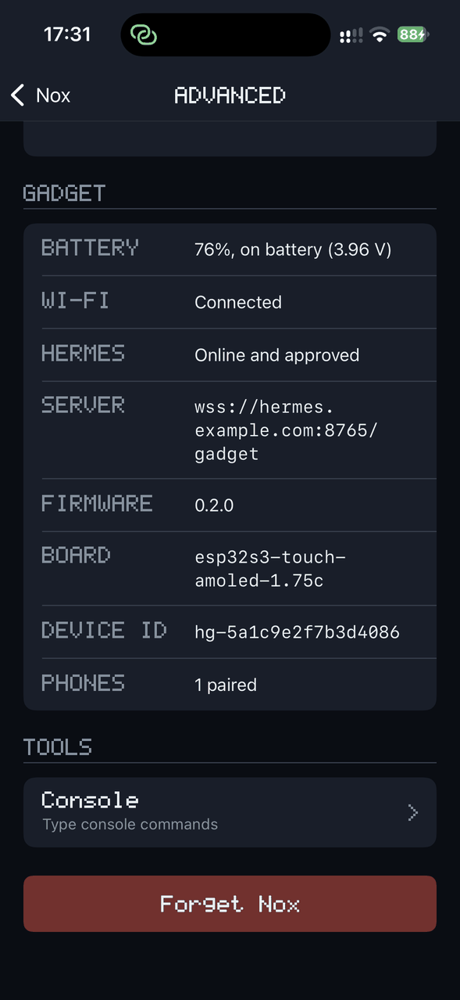
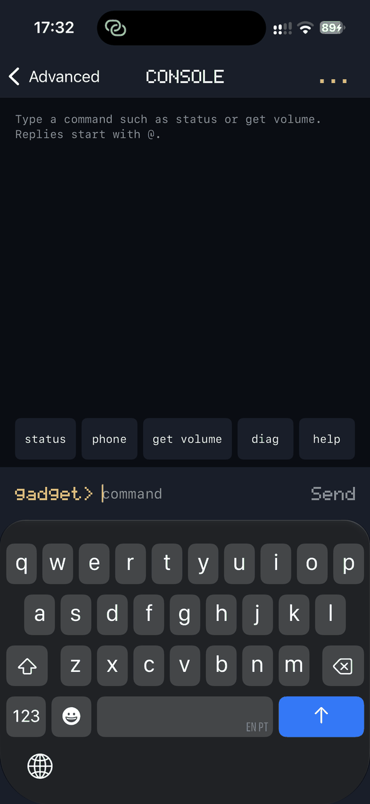

# Hermes Gadget Companion

An iOS app for [Hermes Gadget](https://github.com/Adolanium/hermes-gadget-sdk) devices. It pairs with a gadget over Bluetooth LE to set up Wi-Fi, change settings and show the device's status.

The gadget's side of the link is described in the SDK's [protocol guide](https://github.com/Adolanium/hermes-gadget-sdk/blob/main/docs/protocol.md#phone-app-over-bluetooth). The app sends the same console commands as the gadget's USB console. Bluetooth is experimental in the firmware and off on every board until it passes the SDK's [Bluetooth checks](https://github.com/Adolanium/hermes-gadget-sdk/blob/main/docs/hardware-validation.md#bluetooth).

## Screenshots

Taken in the app's demo, so the gadget, networks and server are made up.

<p>
  
  
  
  
   prompt">
</p>

## Status

The SwiftUI interface, iOS 17 or later, with a Core Bluetooth link to the gadget (`BluetoothGadgetLink`) behind the `GadgetLink` protocol. `MockGadgetLink` acts out mock scenarios for trying screens without a gadget.

Without a gadget, tap **Try the demo** on the first screen: pretend gadgets to explore every screen, also handy for screenshots. It isn't kept across launches. To switch between real Bluetooth and the other mock scenarios, long-press any screen's title for a second to open the debug menu. The choice is kept across launches; the launch argument `-mockScenario <name>` sets it too.

The pixel font, the mascot frames and the app icon come from the SDK's firmware. To regenerate them (the icon needs Pillow):

```bash
python3 scripts/generate-assets.py ~/path/to/hermes-gadget-sdk
python3 scripts/make-icon.py ~/path/to/hermes-gadget-sdk
```

## Building

The app is a Swift package built with [xtool](https://github.com/xtool-org/xtool), so it builds on Linux as well as macOS.

```bash
xtool dev build       # builds xtool/HermesCompanion.app
xtool dev             # builds, signs and installs on a connected iPhone
```

The app's logic is in the `GadgetKit` package, which needs only Foundation: `swift test --package-path GadgetKit` runs its tests on Linux or macOS.

Installing on a phone needs `xtool auth login` with your Apple ID. Without a paid developer account, the app's signature expires after seven days and needs reinstalling.

## License

MIT; see [LICENSE](LICENSE). The mascot art is Hermes Agent's (MIT, © 2025 Nous Research); see [NOTICE](NOTICE).
